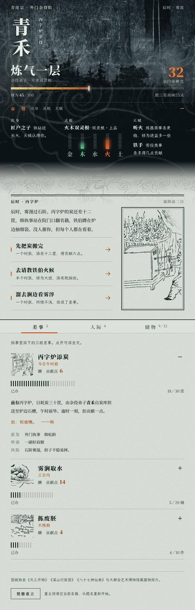

# Tavern Aesthetic

为角色扮演、互动小说、游戏面板、人物档案和叙事型网页提供沉浸式界面设计指导的 AI Skill。

重点包括：

- 作品独有的视觉身份。
- 插画主导的画面：插画决定版面重心，而不只是顶栏或方框里的配图。
- 界面与世界观的融合：信息用世界里原本的格式呈现。
- 插画素材优先（AI 生图或网络收集），代码手绘只作概念验证占位。
- 克制道具，但不克制画面；全部可见区域保持同一质量线。
- 中文可读性与可操作的实际界面。

复杂界面按分阶段流程推进：先定调与构图，再把核心样板做到成品精度，然后逐模块扩展和整体精修，以达到作品级完成度。

独立于 SillyTavern 和具体前端框架，优先沿用项目已有实现。有明确视觉需求时，可以按需使用现有 AI 生图能力。

## 安装

安装到 Codex 的个人 Skill 目录：

```sh
git clone https://github.com/n0ctx/tavern-aesthetic.git ~/.agents/skills/tavern-aesthetic
```

Claude Code 可安装到 `~/.claude/skills/tavern-aesthetic`。若目标目录已存在，请先检查其中内容，避免覆盖已有安装。

## 使用

在支持 Skill 的 AI 工具中显式调用 `tavern-aesthetic`，并说明题材、页面用途、现有项目路径和具体需求。例如：

> 使用 tavern-aesthetic，为这个互动小说项目设计角色档案页，突出角色的背景与关键操作，并保证中文阅读体验。

本 Skill 适用于沉浸式叙事界面，不因普通网页开发任务自动触发。仅要求设计方案时，不擅自修改代码。

## 示例

下图是使用本 Skill 生成的修仙题材角色卡前端，720px 宽，主界面展开命格状态。



- 主视觉与版图使用古画、版画和博物馆藏品照片，均为公有领域或 CC0。这些是借用的历史作品，不是为本作原创。
- 生成时没有 AI 生图工具，所以人物立绘没有专属素材，玩家角色只用竖排道号代替。
- 这是测试产出，不是完成品。已知问题：建档页下半部分有留白；同一幅图的局部在多个模块中重复出现。

## 文件

- [SKILL.md](SKILL.md)：目标、核心原则、任务分级、执行流程、视觉复查和交付要求。
- [references/design-knowledge.md](references/design-knowledge.md)：设计知识库，包括各设计维度的手法、跨维度取舍和失败模式。
- [references/workflow.md](references/workflow.md)：复杂任务的分阶段流程、通过标准、复查方法、回退规则与设计记录模板。
- [references/asset-sources.md](references/asset-sources.md)：按需素材来源与许可核对指引。
- [references/research.md](references/research.md)：研究依据、来源与局限。
- [docs/](docs/)：示例截图。
